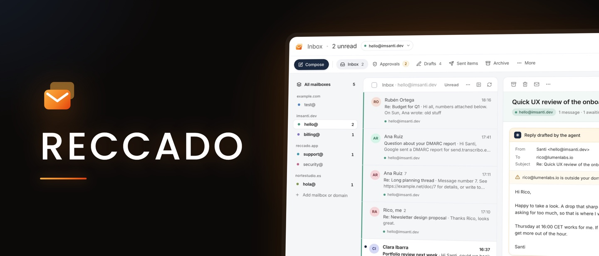

# Reccado — Brand & Style Guide

The visual identity for Reccado. Use this when creating any asset (banners, social cards,
favicons, slides) so everything stays consistent.

The concept: Reccado is a *self-hosted, edge-native email inbox on Cloudflare* — receive, store,
thread and reply to mail from your own domains, running entirely on Cloudflare (Workers, Durable
Objects, R2, D1, Queues), with an optional MCP layer so AI agents can read, triage and draft mail. The name is the Spanish and Portuguese *recado* ("a message left
for someone") with the family's doubled-consonant twist (·cc) — you leave a *recado* and your
agent handles it. The identity is **premium glassmorphism** — translucent **stacked glass
envelopes** (messages arriving, queued and handled at the edge) in a Cloudflare amber→orange
iridescent gradient, glowing on a deep dark surface. Dark-mode-first, modern, fancy. It shares the
family DNA with Eccos (same glass language) but swaps the relay-tiles motif for envelopes and the
green palette for Cloudflare orange.



---

## Logo / wordmark

- **Logomark**: a stack of **translucent glass envelopes / letters** with depth and inner glow
  (`assets/avatar.png`). It reads as layered mail passing through the edge and is the brand's
  hero shape.
- **Wordmark**: the word **RECCADO** in a bold geometric sans-serif, white, on the dark surface.
- **In imagery**: uppercase `RECCADO`. **In prose**: title-case `Reccado`.
- **Flat mark** — two stacked envelopes in the amber→orange→ember gradient
  (`assets/logomark.svg`; drawn from `src/lib/reccado-mark.ts`). It is what the app header, the
  sign-in pages and the favicon use, because the full glass render turns to mush below ~64 px.
- **Favicon** is that flat mark on the Slate-dark tile (`public/favicon.svg`, plus
  `favicon.ico`, `logo192.png`, `logo512.png` rendered from it).
- Give the mark generous clear space. Don't stretch, rotate, or flatten it into a dated glossy
  "white glyph on an orange squircle" app icon — keep the glass depth.

## Color palette

Built on the **Cloudflare-orange family** (Reccado runs entirely on Cloudflare), pushed into a
vibrant **amber→orange→ember iridescent** range for the glass, on near-black surfaces.

| Token | Hex | Use |
|---|---|---|
| **Reccado Orange** (primary) | `#F38020` | Brand anchor: accents, links/CTAs, the `PRs welcome` badge |
| **Glow Amber** (bright) | `#FBAD41` | Glass highlights, the brightest gradient stop |
| **Ember** (secondary) | `#E2400F` | The deep, warm end of the glass gradient |
| **Iridescence** | gold/rose hints | Emergent refraction in the glass — don't force a fixed hex |
| **Charcoal** (surface) | `#0C0A09` | Primary dark surface / background (warm near-black) |
| **Slate-dark** (raised) | `#161310` | Cards, the favicon squircle |
| **White** | `#FFFFFF` | Wordmark and text on dark |
| **Paper** | `#FAF7F4` | Rare light-context surface |

**Material — glass**: translucency, layered depth, soft inner glow, subtle reflections and a
warm orange halo. Surfaces are **dark by default**; the glass and glow provide the color.

## Typography

Open-source (SIL OFL) fonts only — assets should be reproducible by anyone.

- **Display / wordmark** — geometric sans: **Poppins** or **Montserrat** (SemiBold/Bold), white.
- **Body / UI** — **Inter**.
- **Code / mono** — **JetBrains Mono**, or the system `ui-monospace` stack.

## Motif & principles

- **Stacked glass envelopes** *(logomark)* — translucent letters / envelopes stacked with depth =
  mail received, queued and delivered. The core shape; the favicon is its flat, simplified form.
- **Glow** — a soft orange halo behind the glass on the dark surface.

**Do**: lead with the glass-envelopes motif; keep depth, translucency and the orange glow; dark
surfaces; one accent family (amber→orange→ember); the only in-image text is the wordmark
`RECCADO`.

**Don't**: no flat "orange squircle + white glyph" app-icon clichés; no photos of people; no
literal paper-mail clip-art or postage-stamp kitsch; no competing colors; don't bake
taglines/body copy into images (add real text next to them); don't use the detailed glass render
at tiny sizes — use the flat favicon.

## Asset generation recipe

The committed banner (`assets/banner.jpg`) shows **the product itself**: the wordmark and the
flat logomark on the dark surface, next to a real screenshot of the web inbox
(`assets/screenshot-inbox.jpg`) lifted on the orange glow. Its source is the hand-authored
`assets/banner.html`, so it is **fully reproducible with no image generation**. Retake the
screenshot from a local dev server when the UI changes. The earlier gpt-image-2 "edge flow" hero
(glass envelopes streaming out of a portal) is kept below as a recipe for social art.

**Reproduce the current banner** (no credits, macOS):

```bash
CHROME="/Applications/Google Chrome.app/Contents/MacOS/Google Chrome"
"$CHROME" --headless=new --disable-gpu --hide-scrollbars \
  --force-device-scale-factor=2 --window-size=1440,617 \
  --timeout=6000 --default-background-color=00000000 \
  --screenshot=banner@2x.png "file://$PWD/docs/assets/banner.html"
sips -Z 1440 banner@2x.png --out banner-1440.png
sips -s format jpeg -s formatOptions 82 banner-1440.png --out docs/assets/banner.jpg
```

**Logomark** — `model: midjourney-v8.1`, `aspectRatio: 1:1`, `resolution: 2K`:

> A premium app icon: an isometric stack of translucent rounded glass envelopes and letters with
> depth, soft reflections and inner glow, in a vibrant amber-orange to ember iridescent gradient,
> on a deep charcoal background. Ultra-clean, minimal, premium, centered. No text, no letters.

**Hero art, gpt-image-2 ("edge flow")** (the previous banner). Generated with OpenAI **gpt-image-2**. Easiest
path: Codex's native image tool — enable once with `image_generation = true` under `[features]` in
`~/.codex/config.toml` (or `codex features enable image_generation`) and restart the session; **no
OpenAI API key needed**. Generate at landscape `1536x1024`, quality `high`, then crop/fit to
`1440x617` and export JPG (see post-process). Verify the wordmark spells `RECCADO` exactly;
regenerate if not. **The exact prompt used for the committed banner:**

> Ultra-premium wide cinematic hero banner, dark mode, 21:9. A dramatic 3D scene: translucent
> iridescent glass envelopes and letters streaming across the frame out of a glowing amber-orange
> light rift / portal on the right, with volumetric god-rays, floating glowing particles, soft
> bokeh, depth and gentle motion. The glass is an amber-to-orange-to-ember iridescent gradient with
> real refraction, caustics and thin bright edges. On the left, the wordmark "RECCADO" in a refined
> distinctive geometric display sans-serif with elegant tight tracking, crisp white with a faint
> warm glow and a subtle iridescent sheen along the letter edges, perfectly spelled uppercase. Deep
> warm charcoal (#0C0A09) background. Editorial, Apple-keynote-grade, premium. The only text in the
> image is "RECCADO" — nothing else.

**Post-process** (macOS, no extra tooling):

```bash
sips -c 1262 2944 banner.png --out crop.png   # 16:9 → 21:9 hero, centered
sips -Z 1440 crop.png --out banner-1440.png
sips -s format jpeg -s formatOptions 82 banner-1440.png --out banner.jpg   # photographic → JPG
sips -c 1500 1500 logo.png --out icon.png      # drop baked text, square
```

> Keep correctly-spelled in-image text to the wordmark only; everything else (taglines, badges)
> is real text placed next to the image. For the favicon, hand-author the flat envelope in SVG.

## Asset inventory

| Asset | Path | Use |
|---|---|---|
| **Hero banner** | `assets/banner.jpg` | README header, 1440×617 (21:9), dark glass |
| **Logomark / avatar** | `assets/avatar.png` | 512×512 glass stacked-envelopes — logo & GitHub/social avatar |
| **Favicon** | `public/favicon.svg` · `public/favicon.ico` · `public/logo192.png` · `public/logo512.png` | Flat simplified envelope (legible small) |

_Full-resolution sources are kept outside the repo; regenerate from the recipe above when needed._
